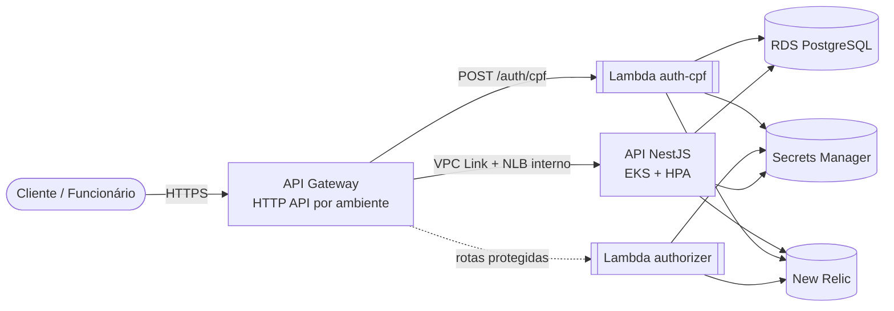

# 🛠️ FIAP Tech Challenge - Oficina Mecânica
---

## 📖 Sobre o Projeto
Este projeto implementa uma API backend para o domínio de uma oficina mecânica, com foco nos processos operacionais críticos: criação de ordens de serviço, diagnóstico técnico, geração automática de orçamento, aprovação ou recusa do cliente, reserva de peças em estoque, execução do serviço, faturamento e liberação do veículo para entrega.

A solução é estruturada de forma modular e orientada a domínios (Clean Architecture e DDD), o que permite evoluir a infraestrutura sem acoplar as regras de negócio a ela. Na fase 3, a API passa a rodar em uma arquitetura de nível corporativo na AWS, com API Gateway, autenticação serverless por CPF, banco gerenciado, infraestrutura como código em repositórios separados e observabilidade completa.

## 🎯 Objetivos da Fase 3

- **API Gateway como entrada única:** todas as requisições passam por uma HTTP API do Amazon API Gateway, com throttling, access log e correlation id.
- **Autenticação serverless por CPF:** uma função Lambda valida o CPF, consulta o cliente e seu status no banco e emite um JWT; um Lambda Authorizer protege as rotas da API.
- **Banco gerenciado:** PostgreSQL no Amazon RDS, uma instância por ambiente, com modelagem revisada (status do cliente, histórico de status da OS e índices).
- **Infraestrutura como código:** EKS, rede, RDS, API Gateway e Lambdas em Terraform, distribuídos em 4 repositórios com CI/CD e `main` protegida.
- **Ambientes de homologação e produção:** `develop` publica em hml e `main` em prd, em todos os repositórios.
- **Observabilidade:** New Relic com APM, logs JSON correlacionados, métricas do Kubernetes e das Lambdas, eventos de negócio, monitor de disponibilidade, dashboards e alertas.
- **Documentação arquitetural:** diagramas de componentes e de sequência, RFCs, ADRs e diagrama ER.

---

## 🏗️ Arquitetura



| Documento | Conteúdo |
| --- | --- |
| [Arquitetura](./docs/arquitetura.md) | Componentes, ambientes, repositórios, diagramas de sequência (autenticação por CPF e abertura de OS), CI/CD e observabilidade |
| [Modelo de dados](./docs/modelo-dados.md) | Justificativa do PostgreSQL/RDS, diagrama ER, relacionamentos e ajustes da fase 3 |
| [RFCs](./docs/rfcs) | [0001 Nuvem (AWS Learner Lab)](./docs/rfcs/0001-nuvem-aws-learner-lab.md) · [0002 Banco (PostgreSQL/RDS)](./docs/rfcs/0002-banco-postgresql-rds.md) · [0003 Autenticação (Lambda + JWT)](./docs/rfcs/0003-autenticacao-lambda-jwt.md) · [0004 Observabilidade (New Relic)](./docs/rfcs/0004-observabilidade-new-relic.md) |
| [ADRs](./docs/adrs) | [0001 REST via API Gateway](./docs/adrs/0001-rest-sincrono-via-api-gateway.md) · [0002 HPA](./docs/adrs/0002-escalabilidade-com-hpa.md) · [0003 Um cluster, namespaces por ambiente](./docs/adrs/0003-um-cluster-namespaces-por-ambiente.md) · [0004 State remoto no S3](./docs/adrs/0004-terraform-state-remoto-s3.md) · [0005 Logs JSON com correlation id](./docs/adrs/0005-logs-json-correlation-id.md) · [0006 Rollout por checksum do Secret](./docs/adrs/0006-rollout-por-checksum-do-secret.md) |
| [Infraestrutura e operação](./docs/INFRASTRUCTURE.md) | Execução local, deploy, pipelines, configuração do GitHub, ciclo de vida no Learner Lab e diagnóstico |

### Repositórios

| Repositório | Responsabilidade |
| --- | --- |
| **tech-challenge** (este) | API NestJS, manifests Kubernetes (Kustomize hml/prd) e deploy no EKS |
| [oficina-infra-k8s](https://github.com/Guribeiro/oficina-infra-k8s) | Terraform: VPC, EKS, ECR, add-ons, API Gateway, authorizer, dashboards e alertas New Relic; scripts de bringup/teardown |
| [oficina-infra-db](https://github.com/Guribeiro/oficina-infra-db) | Terraform: RDS PostgreSQL e segredos no Secrets Manager |
| [oficina-lambda-auth](https://github.com/Guribeiro/oficina-lambda-auth) | Lambdas de autenticação por CPF e authorizer JWT (Node.js + TypeScript) |

### Ambientes

| Ambiente | Branch | URL base (API Gateway) |
| --- | --- | --- |
| Homologação (`hml`) | `develop` | `https://rmji4h1x6b.execute-api.us-east-1.amazonaws.com` |
| Produção (`prd`) | `main` | `https://5redxihir2.execute-api.us-east-1.amazonaws.com` |

Os ambientes rodam no AWS Learner Lab e são destruídos entre sessões para economizar crédito; a cada recriação (`scripts/bringup.sh` do infra-k8s) as URLs mudam e são impressas ao final. Em cada ambiente:

- Swagger: `<URL base>/docs`
- Health check: `<URL base>/api/health`
- Autenticação de cliente: `POST <URL base>/auth/cpf`

---

## 🚀 Tecnologias Utilizadas


### Categorias
- **Linguagem & Runtime:** Node.js, TypeScript
- **Framework & Core:** NestJS, Express, Passport JWT
- **Banco de Dados & ORM:** PostgreSQL (Amazon RDS), Prisma ORM com Driver Adapter
- **Nuvem:** Amazon EKS, ECR, RDS, API Gateway (HTTP API), Lambda, Secrets Manager, CloudWatch Logs
- **Infraestrutura como código:** Terraform (state remoto no S3), Kustomize, Helm
- **Observabilidade:** New Relic (APM, logs, Kubernetes, Lambda, Synthetics), pino
- **CI/CD:** GitHub Actions com GitHub Environments
- **Documentação:** Swagger / OpenAPI, Mermaid
- **Testes & Qualidade:** Vitest, ESLint, SonarQube

---

## 🗂️ Estrutura de Pastas
A aplicação segue um padrão modular com forte separação entre módulos de negócio, casos de uso, controladores e infraestrutura, com cada contexto encapsulando suas regras e integrações.

### Estrutura representativa
```text
src/
├── core/                         # Núcleo compartilhado de domínio
│   ├── entities/                 # Entidades, agregados e listas observadas
│   ├── errors/                   # Erros de domínio e de casos de uso
│   ├── events/                   # Eventos de domínio
│   ├── repositories/             # Contratos de repositórios
│   ├── types/                    # Tipos compartilhados
│   └── either.ts                 # Resultado de sucesso ou erro
├── generated/                    # Código gerado pelo Prisma
├── infra/                        # Adaptadores e integrações de infraestrutura
│   ├── auth/                     # Estratégias e guards de autenticação
│   ├── cryptography/             # Serviços de criptografia
│   ├── database/                 # Módulo de banco e integração com Prisma
│   ├── gateways/                 # Gateways para serviços externos
│   ├── health/                   # Health checks da aplicação (inclui o banco)
│   ├── logging/                  # Logs JSON (pino) com correlation id
│   ├── observability/            # Porta Telemetry e adaptador New Relic
│   ├── http/                     # Módulo HTTP, DTOs, erros e presenters
│   ├── nest/                     # Módulo raiz e configuração do NestJS
│   ├── terraform/                # Terraform do ambiente local (Kind)
│   └── main.ts                   # Bootstrap da aplicação
├── modules/                      # Módulos e contextos de negócio
│   ├── autenticacao/             # Login e autenticação JWT
│   ├── estoque/                  # Produtos, estoque e reservas
│   ├── faturamento/              # Faturamento e webhook de pagamento
│   ├── liberacao/                # Termo de liberação e entrega
│   ├── notificacoes/             # Integração de notificações
│   └── os-orcamento/             # Clientes, veículos, OS e orçamentos
├── shared/                       # Componentes compartilhados da aplicação
│   └── domain/                   # Elementos compartilhados de domínio
└── teste/                        # Helpers para testes
```


### Padrão de organização
- **Modules:** representam os bounded contexts do negócio.
- **Controllers:** expõem os endpoints HTTP.
- **DTOs:** definem e validam os contratos de entrada e saída da API.
- **Infra:** concentra a integração com NestJS, Prisma, autenticação, logs, observabilidade e documentação.
- **Prisma Schema:** define o modelo relacional ([diagrama ER](./docs/modelo-dados.md)).
- **k8s/:** manifests Kustomize (`base` e overlays `hml`/`prd`) usados pelo `scripts/deploy.sh`.

---

## ✨ Funcionalidades Principais
- Criação e acompanhamento de ordens de serviço, com histórico de status.
- Cadastro de clientes (com status ativo, inativo ou bloqueado), veículos, serviços, mecânicos e recepcionistas.
- Geração automática de orçamento após o diagnóstico técnico.
- Aprovação, recusa e renegociação de orçamento.
- Reserva e controle de estoque de peças e insumos.
- Finalização de execução da OS e dedução automática de estoque.
- Emissão de fatura e webhook de confirmação de pagamento.
- Geração de termo de liberação e fluxo de entrega do veículo.
- Consulta pública da situação da OS por placa e documento.
- Métricas de tempo médio de execução de ordens de serviço.
- Autenticação de clientes por CPF (Lambda) e de funcionários por e-mail e senha.

---

## 🔐 Autenticação

| Quem | Como | Token |
| --- | --- | --- |
| Cliente | `POST /auth/cpf` com `{ "cpf": "..." }` (Lambda `auth-cpf`) | JWT `{ sub, role: CLIENTE, cpf }`, 1 hora |
| Funcionário (admin, recepção, mecânico) | `POST /api/sessions/sign-in` com `{ "email", "senha" }` (API) | JWT `{ sub, role }` |

Os dois tokens são assinados com o segredo do ambiente (`oficina/<env>/jwt` no Secrets Manager), validados pelo Lambda Authorizer no gateway e revalidados pela API, que aplica os perfis por rota. Respostas da autenticação por CPF: `200` (token), `400` (CPF inválido), `404` (cliente não encontrado), `403` (cliente inativo ou bloqueado). Detalhes na [RFC 0003](./docs/rfcs/0003-autenticacao-lambda-jwt.md).

Dados de demonstração criados pelo seed:

| Perfil | Credencial |
| --- | --- |
| Cliente ativo | CPF `529.982.247-25` |
| Cliente bloqueado / inativo | CPF `111.444.777-35` / `935.411.347-80` |
| Administrador | `admin@oficina.com` / `senha123` |
| Recepção | `maria.recepcao@oficina.com` / `senha123` |

---

## 📈 Observabilidade

A aplicação envia ao New Relic traces e métricas (agente Node.js), logs JSON com `request_id` e `trace.id`, e os eventos de negócio `OrdemServicoStatusAlterada` e `IntegracaoFalhou`. O cluster (`nri-bundle`) e as Lambdas (layer) completam a visão. Por ambiente, o infra-k8s provisiona:

- **Dashboard Operacional:** latência p50/p95/p99 por rota, throughput, taxa de erro, CPU e memória por pod e nó, réplicas do HPA, Lambdas e disponibilidade.
- **Dashboard Negócio:** volume diário de OS, tempo médio em cada status (diagnóstico, execução, finalização), falhas de integração e erros das Lambdas.
- **Alertas:** taxa de erro, latência p95, CPU, reinício de pods, falhas de integração e no processamento de OS, erros nas Lambdas e health check.

O `x-request-id` gerado pelo API Gateway é devolvido em toda resposta e aparece no access log do gateway, nos logs das Lambdas e em todas as linhas de log da API ([ADR 0005](./docs/adrs/0005-logs-json-correlation-id.md)).

---

## 📚 Documentação da API

- **Swagger:** `<URL base>/docs` em cada ambiente, ou `http://localhost:3000/docs` localmente. Todos os endpoints usam o prefixo `/api`.
- **Postman:** [`docs/postman/oficina-fase3.postman_collection.json`](./docs/postman/oficina-fase3.postman_collection.json) — fluxo completo pelo gateway (autenticação por CPF nos cinco cenários, login de funcionário, abertura de OS com o token do cliente, recusas por falta de token, token inválido e perfil, rastreio público). Defina a variável `baseUrl` com a URL do ambiente e execute as pastas em ordem; os tokens e IDs são preenchidos pelos scripts da coleção. Também pode ser executada com `npx newman run docs/postman/oficina-fase3.postman_collection.json --env-var baseUrl=<URL base>`.

---

## ☁️ Deploy e operação na AWS

O deploy é automático: push em `develop` publica em hml e em `main` publica em prd (qualidade → build da imagem no ECR → `scripts/deploy.sh`). A infraestrutura de cada ambiente é provisionada pelos repositórios de infra, e o infra-k8s oferece `scripts/bringup.sh` e `scripts/teardown.sh` para recriar e destruir tudo entre as sessões do Learner Lab. Passo a passo, configuração do GitHub e diagnóstico em [docs/INFRASTRUCTURE.md](./docs/INFRASTRUCTURE.md).

---

## ▶️ Como Executar Localmente
### Pré-requisitos
- Node.js 24+
- Docker e Docker Compose
- npm ou pnpm

### 1) Clone e configure as variáveis de ambiente
Crie o arquivo `.env` na raiz do projeto com base no arquivo de exemplo:
```bash
cp .env.example .env
```

### 2) Suba o ambiente local

O `.env.example` já contém valores locais para o PostgreSQL principal, o banco de testes e o SonarQube. Antes de subir os serviços, revise pelo menos:

- `POSTGRES_USER`, `POSTGRES_PASSWORD` e `POSTGRES_DB`: credenciais e nome do banco principal.
- `DATABASE_URL`: conexão usada pela aplicação local.
- `POSTGRES_TEST_*`: configuração do banco utilizado pelos testes e2e.
- `SONAR_*`: configuração opcional do SonarQube.

Não utilize credenciais de produção no `.env` local e não versione esse arquivo.

```bash
docker compose up -d --build
```

### 3) Aplique as migrations e seed inicial
```bash
docker compose exec app npx prisma generate
docker compose exec app npx prisma migrate deploy
docker compose exec app npm run db:seed
```

A API ficará disponível em:
- API base: http://localhost:3000/api
- Swagger: http://localhost:3000/docs

---

## 🧪 Rodando os Testes
O projeto conta com testes unitários, testes e2e e relatórios de cobertura.

### Testes unitários
```bash
npm test
```

### Cobertura
```bash
npm run test:cov
```

### Testes e2e
```bash
npm run test:e2e
```

### UI de cobertura
```bash
npm run test:all:ui
```

---

## ✅ SonarQube
Este projeto inclui integração com SonarQube para análise de qualidade de código e cobertura.

### Pré-requisitos
- SonarQube rodando localmente em `http://localhost:9000` ou outro host acessível
- `SONAR_TOKEN` configurado no arquivo `.env` ou variável de ambiente
- Node.js instalado e dependências do projeto instaladas

### Executando a análise
```bash
npm run sonar
```

### Variáveis de ambiente úteis
```bash
SONAR_HOST_URL=http://localhost:9000
SONAR_TOKEN=<seu-token-sonarqube>
```

A análise usa a configuração de cobertura em `coverage/lcov.info` e as fontes de `src`.

---

## 📄 Licença
Este projeto está licenciado sob a licença ISC, conforme informado no arquivo de configuração do pacote.
