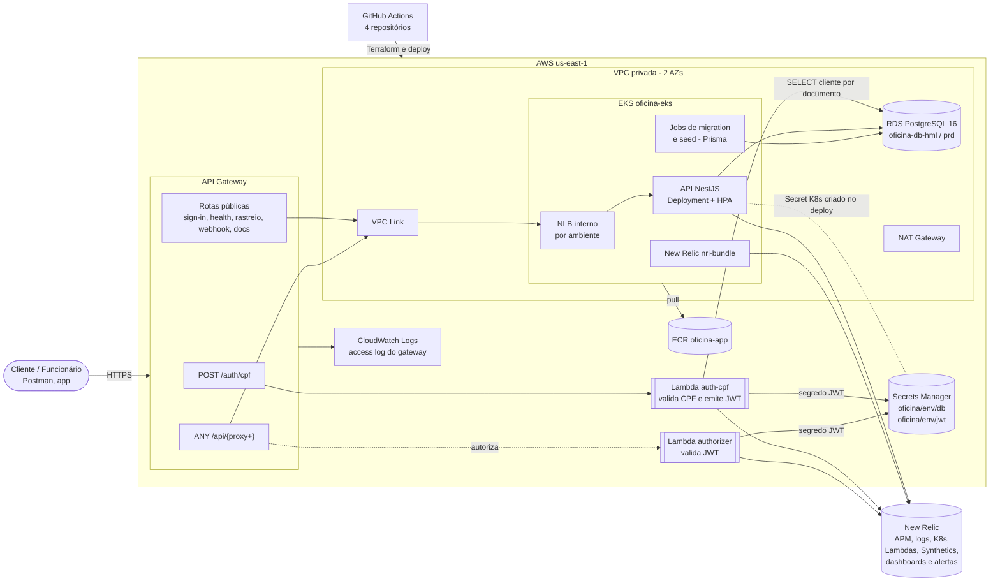
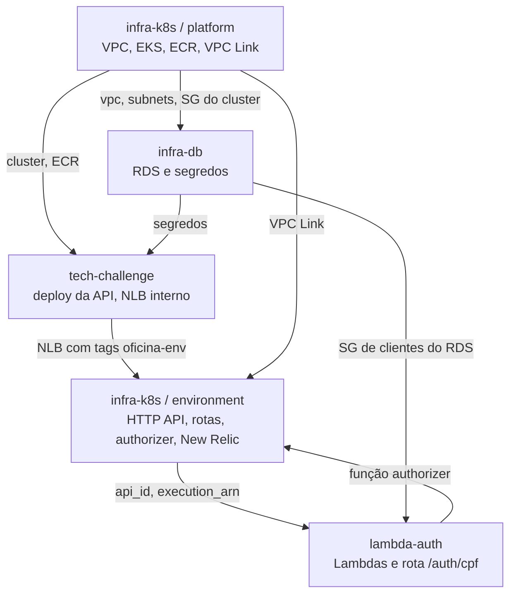
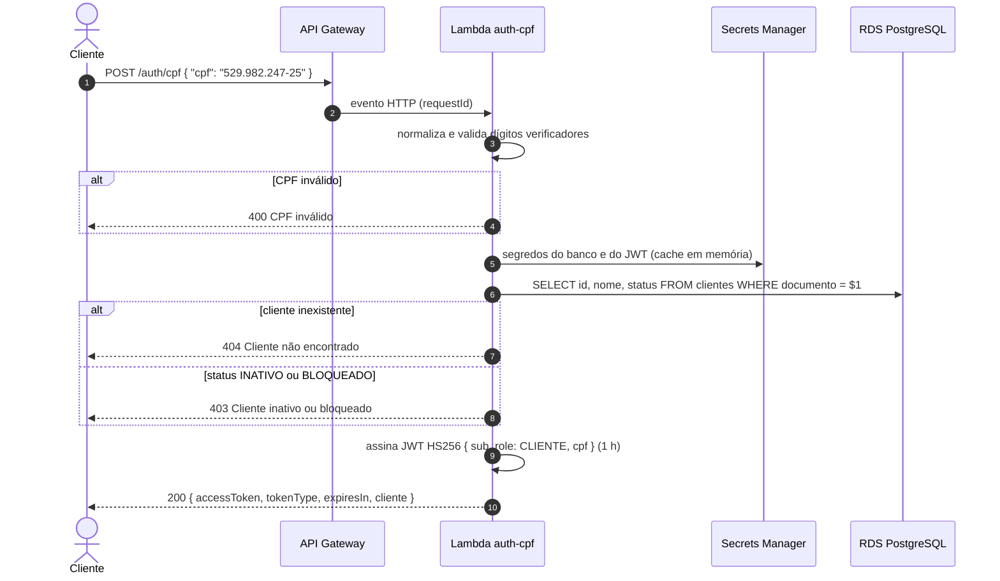
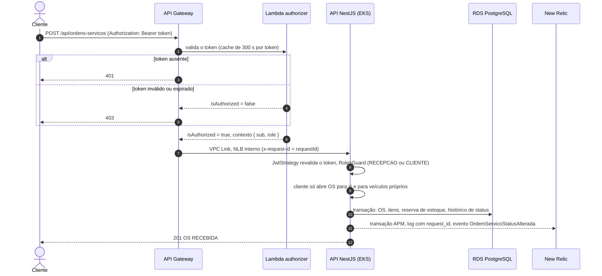
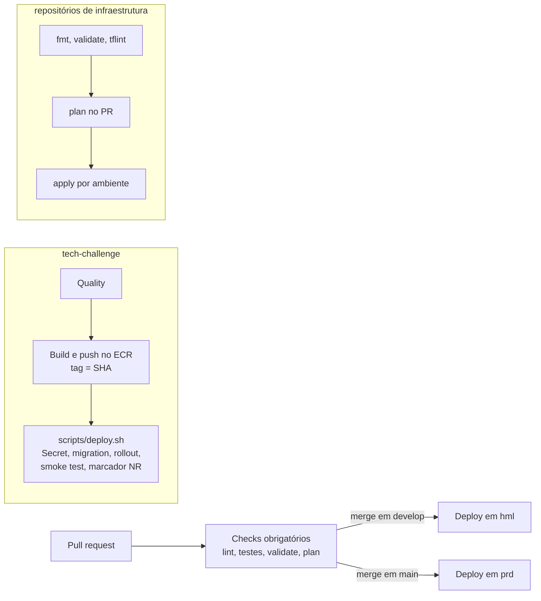

# Arquitetura da solução (Fase 3)

Este documento descreve a arquitetura da Oficina Mecânica na AWS: componentes, ambientes,
repositórios, fluxos de autenticação e de abertura de ordem de serviço, entrega contínua e
observabilidade. As decisões que levaram a este desenho estão registradas nas
[RFCs](./rfcs) e nos [ADRs](./adrs); o modelo de dados está em [modelo-dados.md](./modelo-dados.md).

## Visão geral

Toda requisição externa entra pelo **Amazon API Gateway** (HTTP API). A autenticação de
clientes por CPF é feita por uma **função Lambda** que consulta o banco e emite um JWT; as
rotas protegidas passam por um **Lambda Authorizer** antes de chegar à **API NestJS**, que
roda no **Amazon EKS** e persiste no **Amazon RDS for PostgreSQL**. Segredos ficam no
**AWS Secrets Manager**, e a telemetria (APM, logs, Kubernetes, Lambdas, disponibilidade) é
enviada ao **New Relic**.

### Componentes

| Componente | Responsabilidade | Repositório |
| --- | --- | --- |
| API Gateway (HTTP API) | Ponto único de entrada, roteamento, throttling, access log JSON, propagação do `x-request-id` | [oficina-infra-k8s](https://github.com/Guribeiro/oficina-infra-k8s) |
| Lambda `auth-cpf` | `POST /auth/cpf`: valida o CPF (dígitos verificadores), consulta o cliente no RDS, verifica o status e emite JWT `{sub, role: CLIENTE, cpf}` | [oficina-lambda-auth](https://github.com/Guribeiro/oficina-lambda-auth) |
| Lambda `authorizer` | Valida assinatura, expiração e perfil dos JWT de clientes e funcionários nas rotas protegidas | [oficina-lambda-auth](https://github.com/Guribeiro/oficina-lambda-auth) |
| API NestJS no EKS | Regras de negócio (OS, orçamento, estoque, faturamento, notificações); revalida o JWT e aplica o perfil por rota | este repositório |
| Amazon RDS PostgreSQL | Persistência transacional, uma instância por ambiente | [oficina-infra-db](https://github.com/Guribeiro/oficina-infra-db) |
| Secrets Manager | Credenciais do banco e segredo de assinatura JWT por ambiente | [oficina-infra-db](https://github.com/Guribeiro/oficina-infra-db) |
| EKS, ECR, VPC, VPC Link | Plataforma compartilhada pelos ambientes | [oficina-infra-k8s](https://github.com/Guribeiro/oficina-infra-k8s) |
| New Relic | APM, logs em contexto, métricas do cluster e das Lambdas, Synthetics, dashboards e alertas | agente na API; `nri-bundle` e dashboards no infra-k8s; layer no lambda-auth |

## Ambientes

Um único cluster EKS hospeda os dois ambientes, isolados por namespace; cada ambiente tem sua
própria HTTP API, banco, segredos, Lambdas e dashboards ([ADR 0003](./adrs/0003-um-cluster-namespaces-por-ambiente.md)).

| | Homologação (`hml`) | Produção (`prd`) |
| --- | --- | --- |
| Branch | `develop` | `main` |
| GitHub Environment | `homologacao` | `producao` |
| Namespace | `oficina-hml` | `oficina-prd` |
| Réplicas da API (HPA) | 1 a 2 | 2 a 4 |
| HTTP API | `oficina-api-hml` | `oficina-api-prd` |
| RDS | `oficina-db-hml` | `oficina-db-prd` |
| Segredos | `oficina/hml/db`, `oficina/hml/jwt` | `oficina/prd/db`, `oficina/prd/jwt` |
| Lambdas | `oficina-auth-cpf-hml`, `oficina-authorizer-hml` | `oficina-auth-cpf-prd`, `oficina-authorizer-prd` |
| APM | `oficina-app-hml` | `oficina-app-prd` |

Como cada ambiente assina os tokens com seu próprio segredo, um JWT emitido em hml é recusado
em prd.

## Repositórios

| Repositório | Conteúdo | Pipeline |
| --- | --- | --- |
| [tech-challenge](https://github.com/Guribeiro/tech-challenge) | API NestJS, manifests Kustomize (`k8s/base`, `k8s/overlays/{hml,prd}`), `scripts/deploy.sh` | lint, testes unitários e e2e → build da imagem no ECR → deploy no EKS |
| [oficina-infra-k8s](https://github.com/Guribeiro/oficina-infra-k8s) | Terraform: VPC, EKS, ECR, add-ons, VPC Link, HTTP APIs, authorizer, observabilidade New Relic | fmt, validate, tflint, plan em PR, apply por ambiente |
| [oficina-infra-db](https://github.com/Guribeiro/oficina-infra-db) | Terraform: RDS PostgreSQL e segredos | idem |
| [oficina-lambda-auth](https://github.com/Guribeiro/oficina-lambda-auth) | Lambdas Node.js/TypeScript e seu Terraform (funções e rota `/auth/cpf`) | lint, testes, build → apply por ambiente → smoke test |

Os repositórios de infraestrutura compartilham um bucket S3 de state e leem os outputs uns dos
outros com `terraform_remote_state` ([ADR 0004](./adrs/0004-terraform-state-remoto-s3.md)).
Em todos, a `main` é protegida: alterações entram apenas por pull request com os checks
obrigatórios aprovados.

## Fluxos

### Autenticação do cliente por CPF

Os logs da Lambda saem em JSON com o `request_id` do gateway e o CPF mascarado. Funcionários
(admin, recepção, mecânico) continuam autenticando por e-mail e senha em
`POST /api/sessions/sign-in`, na própria API; os dois tipos de token usam o mesmo segredo e
são aceitos pelo authorizer ([RFC 0003](./rfcs/0003-autenticacao-lambda-jwt.md)).

### Abertura de OS por um cliente autenticado

O authorizer filtra cedo os tokens inválidos, e a API continua validando o token e as regras de
perfil por rota: o gateway não é o único ponto de controle.

## Entrega contínua

- `develop` publica em homologação e `main` em produção, em todos os repositórios.
- O deploy da API cria o Secret Kubernetes a partir do Secrets Manager, roda as migrations do
  Prisma em um Job, aplica os manifests do overlay do ambiente e faz um smoke test em
  `/api/health`. Um checksum do Secret no template dos pods força o rollout quando um segredo
  muda ([ADR 0006](./adrs/0006-rollout-por-checksum-do-secret.md)).
- As credenciais do Learner Lab são temporárias: a cada sessão, o script
  `bootstrap/github-secrets.sh` do infra-k8s atualiza os secrets dos GitHub Environments.
- Entre sessões, `scripts/teardown.sh` e `scripts/bringup.sh` do infra-k8s destroem e recriam
  todo o ambiente para não consumir o orçamento do laboratório.

## Observabilidade

| Sinal | Fonte | Uso |
| --- | --- | --- |
| Traces e métricas da API | Agente New Relic Node.js (`newrelic.cjs`) | Latência por rota, throughput, taxa de erro |
| Logs JSON | pino com `request_id`, `user_id`, `trace.id` (logs in context) | Correlação gateway → API → banco |
| Eventos de negócio | `OrdemServicoStatusAlterada` (com tempo no status anterior), `IntegracaoFalhou` | Volume diário de OS, tempo médio por status, falhas de integração |
| Kubernetes | `nri-bundle` (kubelet, kube-state-metrics, eventos) | CPU e memória por pod, réplicas do HPA, reinícios |
| Lambdas | Layer New Relic (extensão + wrapper) | Invocações, duração e erros |
| Disponibilidade | Monitor Synthetics em `/api/health` pelo gateway | Uptime de ponta a ponta |
| Access log do gateway | CloudWatch Logs, JSON | `requestId`, rota, status, latências, erro do authorizer |

Por ambiente, o Terraform do infra-k8s cria os dashboards **Operacional** e **Negócio** e uma
política de alertas: taxa de erro acima de 5%, p95 acima de 1 s, CPU de pod acima de 80% do
limit, reinício de container, falhas de integração, erros nas rotas de OS e orçamentos, erros
nas Lambdas e health check indisponível ([RFC 0004](./rfcs/0004-observabilidade-new-relic.md)).

O `x-request-id` gerado pelo gateway é o fio condutor: aparece no access log do gateway, nos
logs da Lambda e em todas as linhas de log da API durante a requisição
([ADR 0005](./adrs/0005-logs-json-correlation-id.md)).
