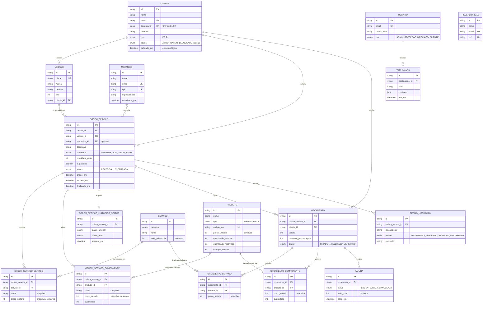

# Modelo de dados

Banco relacional **PostgreSQL 16** no **Amazon RDS** (uma instância por ambiente), acessado
pela API via **Prisma ORM** e pela Lambda de autenticação via `pg`. O schema é definido em
[`prisma/schema.prisma`](../prisma/schema.prisma) e versionado por migrations em
[`prisma/migrations`](../prisma/migrations), aplicadas por um Job Kubernetes a cada deploy.

## Por que PostgreSQL

O domínio é fortemente transacional e relacional: uma ordem de serviço reúne cliente,
veículo, mecânico, itens de serviço e peças, orçamentos versionados, faturas e termos de
liberação, e as mudanças de estado precisam ser atômicas (aprovar um orçamento reserva
estoque, um pagamento libera o veículo). Por isso:

- **Integridade referencial e transações ACID**: chaves estrangeiras entre todas as entidades
  e operações multi-tabela (abertura de OS com itens e reserva de estoque) em uma transação.
- **Consultas analíticas sobre os mesmos dados**: fila de trabalho por status e prioridade,
  tempo médio de execução, histórico de status, com índices compostos.
- **Enums e tipos ricos**: estados de OS, orçamento e fatura como enums no banco (`StatusOS`,
  `StatusOrcamento`, `StatusFatura`), `jsonb` para o contexto das notificações.
- **Serviço gerenciado**: no RDS, backups automáticos, criptografia em repouso, TLS
  obrigatório (`rds.force_ssl = 1`), log de queries lentas e manutenção sem operar servidor.

A comparação com alternativas (DynamoDB, Aurora, banco no próprio cluster) está na
[RFC 0002](./rfcs/0002-banco-postgresql-rds.md).

## Diagrama ER

## Relacionamentos

| Relacionamento | Cardinalidade | Regra de negócio |
| --- | --- | --- |
| Cliente → Veículo | 1 : N | Um veículo pertence a um único cliente; um cliente autenticado por CPF só abre OS para os próprios veículos. |
| Cliente / Veículo → Ordem de serviço | 1 : N | Toda OS referencia o cliente e o veículo atendido (índice composto `cliente_id, veiculo_id`). |
| Mecânico → Ordem de serviço | 0..1 : N | O mecânico é atribuído quando o diagnóstico começa; até lá a OS fica sem responsável. |
| Ordem de serviço → Itens de serviço e componentes | 1 : N | Os itens guardam **snapshot** de nome, preço e tipo: alterações posteriores no catálogo não mudam OS já abertas. |
| Ordem de serviço → Orçamento | 1 : N | O orçamento é **versionado** (`versao`): recusa e renegociação geram nova versão, preservando o histórico. |
| Orçamento → Itens de serviço e componentes | 1 : N | Mesmo padrão de snapshot dos itens da OS, com os valores apresentados ao cliente. |
| Orçamento → Fatura | 1 : N | A fatura nasce do orçamento aprovado; o webhook de pagamento a marca como `PAGA`. |
| Ordem de serviço → Termo de liberação | 1 : N | Emitido no pagamento aprovado ou na rejeição definitiva do orçamento, para liberar o veículo. |
| Ordem de serviço → Histórico de status | 1 : N | Uma linha por transição de status (fase 3), com exclusão em cascata junto da OS. |
| Usuário → Notificação | 1 : N | Notificações internas para funcionários e clientes. |

Valores monetários são inteiros em centavos, evitando erros de arredondamento de ponto
flutuante. `Usuario` guarda as credenciais de quem acessa a API por e-mail e senha
(funcionários e clientes com login); `Cliente`, `Mecanico` e `Recepcionista` guardam os dados
cadastrais. Clientes autenticados pela Lambda usam o `id` de `clientes` como `sub` do token.

## Ajustes da fase 3

Migration [`20261113120000_fase3_modelagem`](../prisma/migrations/20261113120000_fase3_modelagem/migration.sql):

| Mudança | Motivo |
| --- | --- |
| `clientes.status` (`ATIVO`, `INATIVO`, `BLOQUEADO`), padrão `ATIVO`, com índice | A autenticação por CPF precisa distinguir cliente inexistente (404) de inativo ou bloqueado (403). Clientes já excluídos logicamente foram migrados para `INATIVO`. |
| Tabela `ordem_servico_historico_status` | Registro auditável de cada transição de status e base das métricas de tempo por etapa (diagnóstico, execução, finalização), também enviadas ao New Relic. |
| Índice `ordem_servicos (status, prioridade_peso DESC)` | Fila de trabalho por status ordenada por prioridade sem varredura completa. |
| Índices em `ordem_servicos (mecanico_id, status)` e `(criado_em)` | Fila por mecânico e relatórios por período. |
| Índices nas chaves estrangeiras (`veiculos.cliente_id`, itens de OS e de orçamento, faturas, termos, notificações) | O PostgreSQL não indexa FKs automaticamente; os joins e as exclusões passam a usar índice. |
| Índice `faturas (status)` e `notificacoes (destinatario_id, lida_em)` | Consulta de faturas pendentes e de notificações não lidas. |

O parameter group do RDS registra queries acima de 500 ms (`log_min_duration_statement`),
exportadas ao CloudWatch, para acompanhar o efeito desses índices.
