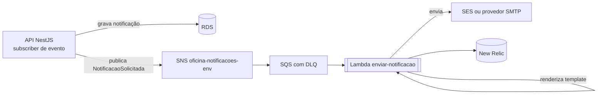

# RFC 0005 — Notificações serverless

- **Status:** proposta (evolução planejada, não implementada nesta fase)
- **Data:** 2026-11-16

## Contexto

O desafio da fase 3 cita adotar soluções serverless para autenticação **e notificações**. A
autenticação foi implementada como Lambda ([RFC 0003](./0003-autenticacao-lambda-jwt.md)). As
notificações continuam dentro da API:

- O módulo `notificacoes` tem 10 subscribers de eventos de domínio (OS em diagnóstico e em
  execução, orçamento enviado, recusado e renegociado, fatura emitida, termo de liberação,
  usuário criado, entre outros).
- Cada subscriber grava a notificação no banco (caso de uso `CriarNotificacao`, consultável em
  `/api/notificacoes`), indicando um template Handlebars (`infra/templates/*.hbs`).
- A gravação emite o evento `NotificacaoCriada`; o subscriber `on-notificacao-criada` envia o
  e-mail pela porta `NotificacaoService`, implementada hoje por `EtherealNotificacaoService`
  (SMTP de testes), que renderiza o template.
- Falhas de envio são registradas como `IntegracaoFalhou` no New Relic e geram alerta.

Os eventos de domínio são despachados no mesmo processo da API: o envio compete por recursos
com as requisições, uma falha do provedor de e-mail só é registrada (não há retentativa) e a
mensagem se perde se o pod for encerrado durante o envio.

## Proposta

Desacoplar o envio com fila e função serverless, mantendo o registro da notificação na API:

1. Um novo adaptador `SnsNotificacaoService` implementa a porta `NotificacaoService` e publica
   a mensagem (destinatário, template e contexto) em um tópico SNS por ambiente. Os
   subscribers e o caso de uso `CriarNotificacao` não mudam.
2. Uma fila SQS assinada no tópico, com **dead-letter queue**, entrega as mensagens a uma
   Lambda `enviar-notificacao` (Node.js + TypeScript, mesmo padrão do `oficina-lambda-auth`),
   que renderiza o template e envia o e-mail.
3. Retentativas automáticas pela fila; mensagens que falharem várias vezes vão para a DLQ, com
   alerta no New Relic.
4. Infraestrutura em Terraform no repositório da Lambda (tópico, fila, DLQ, função e
   permissões), com o mesmo pipeline hml/prd.

## Por que não nesta fase

- Os requisitos obrigatórios da fase pedem a função serverless de autenticação; as
  notificações aparecem só na descrição do desafio.
- O Learner Lab não permite criar roles IAM (a Lambda usaria a `LabRole`) e mantém o SES em
  modo sandbox, com envio só para endereços verificados — o que limita uma demonstração real
  de e-mail.
- O orçamento do laboratório é consumido por cada recurso extra, e o ambiente é destruído e
  recriado entre sessões.

## Consequências da proposta

- **Positivas:** a requisição deixa de depender do provedor de e-mail; retentativas e DLQ
  garantem a entrega; a função escala de forma independente da API; a troca de provedor fica
  restrita à Lambda.
- **Negativas:** mais componentes para operar e monitorar (tópico, fila, DLQ, função) e
  consistência eventual entre o registro da notificação e o envio do e-mail.
- **Impacto no código:** só um novo adaptador da porta `NotificacaoService` e sua configuração
  no módulo; regras de negócio e subscribers ficam iguais, graças à separação entre domínio e
  infraestrutura.
